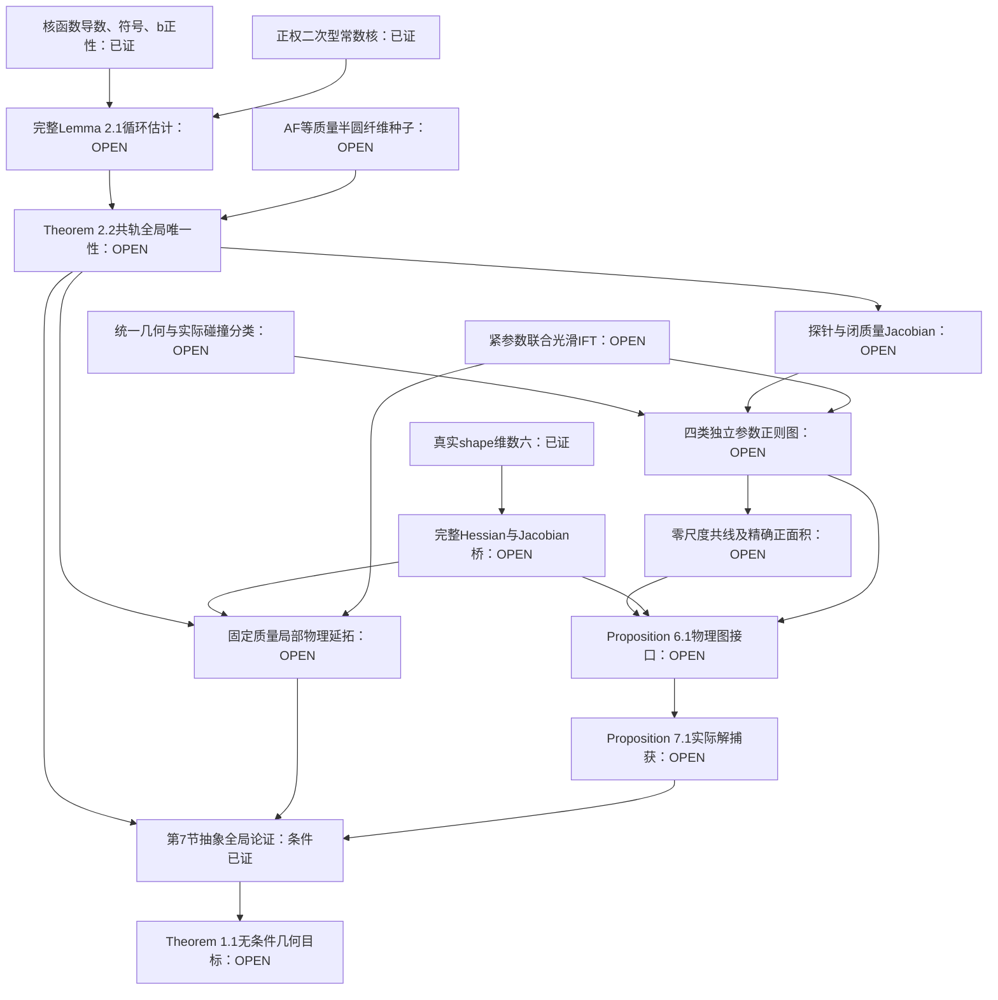

# 提供论文的标签、依赖与外部最低证明义务

> **依赖规划的历史快照。** 以下表格保留原文位置、证明结构及最初最低义务，原图中的 OPEN 和“外部未核验”是早期进度。当前无条件主定理已实现；所需等质量种子也有本项目实际证明。当前逐项状态和真实声明见 `FULL_ASSERTIONS.json`，最终机器验收记录见 `logs/PAPER_ACCEPTANCE.json`，不能以本页早期进度替代它们。

只涉及 2026-10-03 提供的 19 页 `dominant_five_body_ARMA_rewritten.tex/.pdf`。页码/编号从对原 TeX 隔离重建的 `manuscript.aux` 提取，并已确认原 PDF 与重建 PDF 的整篇 layout 文本逐字一致。SHA-256 和限度见 [SOURCE_AUDIT.md](SOURCE_AUDIT.md)。本表不把任何尚未实现的 Lean 命题列为内核已经证明。

## 1. 主证明的内部依赖

| 结果 / 原文编号 | TeX 标签 | 行号 | PDF 页 | 直接依赖与准确作用 |
|---|---|---|---|---|
| 主定理 1.1 | `thm:main` | 72–74；965–992 | 1；18 | Theorem 2.2；Proposition 3.3；Proposition 7.1；正参数局部 IFT 与开闭集合论证。结论为全质量比共同正界、每个有向壳序恰一严格凸相似类、六维 Hessian 非退化。 |
| 循环角 Hessian 2.1 | `lem:cycle` | 116–153 | 2–3 | `f` 符号、严格下降的 `κ`、至多四顶点的平衡流循环分解、Cauchy 不等式。只在角方程的根上使用，不是全角域正 Hessian。 |
| coorbital 唯一性 2.2 | `thm:coorbital` | 155–171 | 3 | Lemma 2.1；角 cut；内部质量紧集上的 properness；proper 局部微分同胚的有限覆盖；AF 等质量半圆纤维一点输入。 |
| 两源探针 2.3 | `lem:probe` | 178–189 | 3–4 | `κ>0` 于短角；`κ'<0`；严格凸函数切线不等式；反射；单源端点。原文独立证明，DHW 的 `cf.` 不应成为整个引理的未审查公理。 |
| 闭质量 Jacobian 2.4 | `prop:closed` | 191–210 | 4 | Lemma 2.1、2.3；四阶斜矩阵秩；正质量扰动；`μᵀJ=0`；`J1=0`；紧性。允许零质量，但角位置须互异且跨度 < π。 |
| Jacobian/Hessian 3.1 | `lem:hessian` | 275–291 | 5 | 极坐标梯度恒等式；正质量行恢复；中心约束空间；齐次性 `D²G(x)x=3Mx`；去旋转与径向分裂。 |
| 紧参数 IFT 3.2 | `lem:product` | 295–303 | 5–6 | 有限维光滑 IFT；连续基图和逆矩阵；紧性的有限子覆盖；相交根球中的局部唯一性粘合。 |
| 内部质量局部分支 3.3 | `prop:local` | 305–313 | 6 | Theorem 2.2；径向 `3I₄`；Lemma 3.2；严格正的基面积；Lemma 3.1。只给 `K ⊂⊂ M` 上统一性，不直接给整个 `M` 上主定理。 |
| 一致几何 4.1 | `prop:uniform` | 323–358 | 6–7 | 投影 gap；内部簇力/势恒等式；外场 Lipschitz 界；当前质量归一平均；cut；极限斜矩阵行列式。第一段适用于所有解，跨度结论仅适用于指定严格凸壳序。 |
| 完全双簇 4.2 | `prop:pair-scale` | 370–426 | 7–8 | Proposition 4.1；距离公式；壳支撑；向量与角方程差；中点恒等式；Lemma 2.3；外部两个角的 coorbital 方程。 |
| 完全三簇 4.3 | `prop:triple-scale` | 429–468 | 8–9 | Proposition 4.1；角平均；支撑；首末角行；以直径归一后的等极限组平均。得到 `ν/d³` 上下界与径向铺展 `o(d)`，尚不是精确 `D₀` 极限。 |
| 三簇内部双簇 4.4 | `prop:nested-scale` | 471–503 | 9–10 | Proposition 4.3；双簇差分论证；近外场导数；宏观当前质量平均。得到 `ν/d³→D₀` 和 `ξ/s³→3D₀`，不要求内层质量份额收敛。 |
| 无碰撞图 §5.1 | 无独立定理标签 | 539–544 | 10 | Proposition 2.4；Lemma 3.2、3.1；基正面积；无碰撞时连续取极限的所有除质量行。 |
| 双簇图 §5.2 | `subsec:pair-chart` | 546–589 | 11 | Proposition 4.2；光滑内部核/Hadamard 差；显式行恢复；边界角 Jacobian `(a₀,D,3D)`；Lemma 3.2、3.1；面积商。 |
| 正规三簇图 §5.3 | `subsec:regular` | 591–644 | 12 | Proposition 4.3；标量严格凸势与对角占优 Jacobian；`L,Bα`；`LJBα` 核排除；Lemma 3.2、3.1；§6 面积正性。 |
| 内嵌三簇图 §5.4 | `subsec:nested` | 646–789 | 13–15 | Proposition 4.4；质量/坐标/行的显式恢复；双尺度光滑核差；边界三角 Jacobian；Lemma 3.2、3.1；§6 面积正性。 |
| 零尺度共线性 §6.1 | `eq:regular-parallel`、`eq:nest-parallel` | 796–864 | 15–16 | 等边背景；显式慢特征方向；标量根；Cartesian 正尺度一阶项；图的局部唯一性；零参数光滑延拓。 |
| 正规三簇面积 | `eq:regular-area` | 874–890 | 16 | 光滑除边；零尺度精确共线性；Hadamard 因子；单位圆三角面积及局部参数紧性。面积为 `t³ C₁`。 |
| 内嵌三簇面积 | `eq:nest-area` | 894–925 | 17 | 除边 `tη,t`；精确 `u₂z₁-u₁z₂=0`；Hadamard 因子；单位圆面积；`α∈[0,1]` 紧性。面积为 `t³η C₂`。 |
| 图接口 6.1 | `prop:chart-interface` | 928–938 | 17 | 四图的光滑性/捕获；§6 正面积；正尺度行恢复；固定质量参数；Lemma 3.1。不能只形式化其声明而跳过图构造。 |
| 全解捕获 7.1 | `prop:connection` | 949–963 | 18 | Proposition 4.1、4.2；三簇尺度比二分；四图的捕获；Proposition 6.1；恢复原旋转规范。共同区间是在抽取子列后获得。 |

## 1a. 当前形式化依赖图

图中的“条件已证”只指明确参数下的 Lean 证明；箭头不是已有物理接口实例。

## 2. 关键公式的来源及必须保留的条件

| 公式 / 编号 | 标签 | 行号 / 页码 | 最低形式化义务 |
|---|---|---|---|
| 质量及角域 (1.1)、(2.1) | `eq:masses`、`eq:angle-domain` | 67–70 / p1；83–87 / p2 | `μᵢ>0`、总和 1、有向顺序和 `<π`；边界质量扩展须另声明。 |
| 角核与导数 (2.2)–(2.4) | `eq:kernel`、`eq:co-equations`、`eq:kappa` | 91–112 / p2 | 奇延拓后的负角符号；距离非零；`κ' <0` 的正分母；`κ(h)=9/4`。 |
| full CC、action、除质量残差 (3.1)–(3.8) | `eq:cc`、`eq:action`、`eq:R`、`eq:T`、`eq:polar-gradient`、`eq:Q` | 215–273 / p4–5 | 区分中心 `x` 与主星相对 `q`；`ε>0`、正质量时梯度等价；离根的角加权恒等式不可省略。 |
| cut 与壳支撑 (4.2)、(4.4) | `eq:full-cut`、`eq:support` | 350–352、365–367 / p7 | 首段内部力按当前质量精确抵消；支撑仅用于实际严格凸、正向相邻壳边。 |
| 双簇差、中点 (4.6)、(4.8)、(4.9) | `eq:pair-qdiff`、`eq:pair-vdiff`、`eq:midpoint` | 391–403、419–422 / p7–8 | 分母正、`δ>0`；径/切分量的符号；中点恒等式必须精确而非仅极限。 |
| Hadamard 差与内部核 (5.2)、(5.3) | `eq:hadamard`、`eq:regular-int` | 514–535 / p10 | 零尺度光滑除差；源位置及 `X` 在目标差中固定；所有 `Wᵢⱼ>0`；有符号延拓与物理距离的区别。 |
| 正规线性矩阵 (5.11)、(5.12)、(5.15) | `eq:internal-J`、`eq:LB`、`eq:Kreg` | 605–615、639–641 / p12 | 零质量时不丢探针行；`LBα=I₂`、`αᵀBα=0`、`αᵀJ=D₀αᵀ`，必须从明确条目推导可逆性。 |
| 内嵌恢复与双尺度核 (5.19)–(5.23) | `eq:nest-recovery`、`eq:nest-distances`、`eq:nest-angular`、`eq:nest-kernel-difference`、`eq:nest-radial` | 669–740 / p13–14 | 坐标/行变换只在正尺度物理恢复；延拓在零面光滑；除 `η` 差改写成固定积分区间；无 `ε/t` 或 `ε/η` 偷加条件。 |
| 内嵌角矩阵 (5.26) | `eq:nest-angle-J` | 763–771 / p14–15 | 完整条目与导数；对角 `D₀,3D₀,9D₀`；总 determinant 为 `2187D₀³`。 |
| 慢矩阵/特征值 (6.1)、(6.2) | `eq:bg-matrix`、`eq:slow` | 803–821 / p15 | `a³=1+ε`；慢方向 `n`；`d(0)=D₀`；`dl=D₀l⁻²`；共同反作用修正的一阶消失。 |
| 精确共线、面积 (6.6)–(6.10) | `eq:regular-parallel`、`eq:nest-parallel`、`eq:circle-area`、`eq:regular-area`、`eq:nest-area` | 847–912 / p16–17 | 不允许把零尺度精确恒等式替换为 `O(ε)`；导数包含图根对 `t` 的依赖；面积商严格正后才取独立产品邻域。 |

## 3. 外部文献的最低输入及原稿已经自行证明的范围

| 引用键 / 书目信息 | 原文位置 | 本稿实际用途 | 最低额外核验 / 证明义务 |
|---|---|---|---|
| `AF`；Albouy–Fu, 2009, DOI `10.1098/rspa.2009.0115` | 行 64、170；书目 1008–1011 | **关键外部计数输入**：等质量四卫星分类中，开放半圆有向角域恰一根，并有反序对称性。 | 取得原文准确陈述及其等价变换，或在本项目证明等质量域的 `∃!` 种子。不能只导入“等质量所有构型分类”，也不能不核对标签/反射商就当作纤维一点。仅提供稿件未含 AF 正文，当前状态为外部未核验。 |
| `CCLM`；Corbera–Cors–Llibre–Moeckel, 2015, DOI `10.1137/140978661` | 行 64、90、170、214、311；书目 1023–1026 | `1+3` 的固定正质量结论作为背景；势和矩阵记号；覆盖论证参考；局部续接方法参考。 | 若使用其结论，仅有三个卫星且阈值依赖固定正质量。不能拿其 Theorem 2 作为四卫星、全质量比共同阈值。现稿已写出四卫星径向/角块和 IFT 论证；应证明本稿这一论证。 |
| `DHW`；Deng–Hampton–Wang, 2022, DOI `10.1137/22M1475053` | 行 64、176；书目 1033–1036 | 两源探针估计的参考。 | 本稿 Lemma 2.3 已独立给出证明，最低义务是形式化其 `g'<0` 推导，不需要把整篇论文设为公理。 |
| `Moeckel`；1997, DOI `10.1007/BF02219396` | 行 78；书目 1043–1046 | 小质量簇方法的背景/来源。 | 不提供本稿四种任意退化质量图的共同独立邻域、凸面积因子或全解捕获。§4–§6 的估计必须本项目证明。 |
| `MoeckelCC`；2015, DOI `10.1007/978-3-0348-0933-7_2` | 行 284；书目 1048–1052 | 约束中心构型 Hessian 定义及去对称解释。 | 明确定义 `E`、固定惯量切空间 `T`、旋转核及相似商，证明本稿 Lemma 3.1；可引用定义来源，但不能用定义公理替代等价性证明。 |
| `CLN`；1994, DOI `10.1007/BF00693325` | 行 64；书目 1013–1016 | `1+N` coorbital 模型背景。 | 当前主链不依赖该文未陈述的新定理；角残差与极限须由本稿方程证明。 |
| `CCL`；2011, DOI `10.1007/s10569-010-9316-0` | 行 64；书目 1018–1021 | 三卫星分岔背景。 | 不是四卫星全质量比全局唯一性输入。 |
| `CLO`；2004, DOI `10.1023/B:CELE.0000043569.25307.AB` | 行 64；书目 1028–1031 | 等质量 coorbital 分类背景。 | 无需作本稿主链公理；若替代 AF 种子，仍需准确半圆有向纤维结论。 |
| `Moeckel94`；1994, DOI `10.1007/BF02219187` | 行 64；书目 1038–1041 | 优势质量稳定性背景。 | 非本稿六维全质量比 Hessian 非退化的替代输入。 |
| `OC`；2012, DOI `10.3934/dcds.2012.32.3715` | 行 64；书目 1054–1057 | stacked 构型背景。 | 当前主链无需要导入的实质定理。 |
| `RS`；2004, DOI `10.1023/B:CELE.0000023420.80881.67` | 行 64；书目 1059–1062 | 任意小卫星质量背景。 | “小任意质量”不能未经量词核验解释为本稿共同阈值；当前主链不调用其结论。 |

## 4. 标准工具与不允许隐蔽替代的义务

可从 mathlib 或显式证明导入的标准工具有：有限维 IFT，紧性的有限子覆盖，Bolzano–Weierstrass 子列，有限维矩阵连续性/逆界，均衡有限有向流的循环分解，正权 Cauchy，不同点有序腔室上的凸函数极小值，proper 局部微分同胚的覆盖理论，连通空间中的开闭集合，以及微积分基本定理形式的 Hadamard 因子。每次需落实域、非零分母、连续/光滑性和参数紧性。

尤其不能将下面任一命题命名为 “standard” 然后作为假设获得主定理：

- 四卫星角根在全质量域的唯一性；
- 任意退化质量序列的四型分类及所有实际解进入图根球；
- 两尺度图在质量份额端点上的共同独立参数邻域；
- `t³ C₁`、`t³η C₂` 的精确面积分解及商的统一正性；
- Proposition 6.1 或 7.1 的完整捕获/固定质量共同 ε 区间；
- 主定理的共同阈值、全局唯一性或 Hessian 非退化。

这些都是当前论文内部的主要数学内容。形式化项目可以用显式 `Prop` 记录尚未证明的义务，但带这些义务的条件定理须标为条件结果，不能通过重新命名获得“整篇论文已由 Lean 内核认证”的结论。
